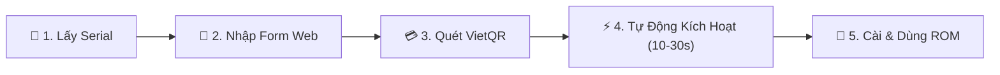

# HyperUR - HyperOS Custom ROM Portal (V3.0)

Cổng thông tin và kho tải ROM Custom Stock-based hàng đầu cho hệ sinh thái thiết bị Xiaomi, Redmi tại Việt Nam.

## 🚀 Tính Năng & Kiến Trúc

- **Pure Semantic HTML5**: Tối ưu tốc độ tải trang, chuẩn SEO, nhẹ và không phụ thuộc framework cồng kềnh.
- **Hỗ trợ danh mục 190 file cấu hình thiết bị (`devices/`)**: Danh mục máy nội địa & quốc tế đầy đủ (Xiaomi, Redmi, POCO).
- **Thiết kế Titanium & Obsidian Glassmorphism**: Tone màu cao cấp, tương phản chuẩn công thái học, hỗ trợ chuyển đổi Light/Dark mode.
- **100% Vector SVG**: Biểu tượng sắc nét, loại bỏ hoàn toàn emoji không đồng bộ.
- **Dynamic Device Module (`devices.js`)**: Module JavaScript duy nhất đảm nhận tải động danh mục thiết bị, tìm kiếm tức thì theo tên/mã máy, lọc theo hãng và mở hộp thoại tải ROM chuẩn `<dialog>`.
- **Tương thích toàn diện**: Bypass Play Integrity mặc định, hoạt động 100% ứng dụng ngân hàng và eKYC sinh trắc học.
- **📧 Email Confirmation**: Hệ thống tự động gửi email xác nhận khi đăng ký serial thành công.

---

## 📁 Cấu Trúc Dự Án

```text
HyperUR_V3/
├── index.html                  # Trang Chủ
├── download.html               # Kho Tải ROM (đồng bộ động từ Google Drive)
├── firmware.html               # Thông Tin FW
├── guide.html                  # Hướng Dẫn Flash
├── serial.html                 # Đăng Ký & Tra Cứu Serial (với Email Confirmation)
├── styles.css                  # Design System
├── api/                        # Backend PHP (Serial, Admin, SePay Webhook, QR Rotation)
├── admin/                      # Trang Quản Trị Hệ Thống
├── json/                       # Configuration & i18n
│   ├── config.js               # API Configuration
│   ├── devices.js              # Device data module
│   └── i18n.js                 # Multi-language support
├── devices/                    # 190 file JSON dữ liệu thiết bị & manifest
├── images/                     # Ảnh render thiết bị
└── README.md                   # Tài liệu dự án
```

---

## 🛠️ Chạy Website Cục Bộ

1. Sử dụng web server tĩnh:
   ```bash
   python -m http.server 8080
   ```
2. Mở trình duyệt: `http://localhost:8080/`

---

## 📧 Hệ Thống Email Confirmation

Khi user đăng ký serial, hệ thống tự động:

1. **Gửi dữ liệu lên Google Apps Script** qua `SERIAL_REGISTER_API_URL`
2. **Google Apps Script xử lý**:
   - Lưu thông tin vào Google Sheets
   - Tự động gửi email xác nhận đến địa chỉ email user đã nhập
   - Email chứa: Serial, Codename, Gói đăng ký, Trạng thái
3. **Thông báo thành công**: Modal hiển thị "Email xác nhận đã được gửi đến..."

### Cấu hình trong `json/config.js`:

```javascript
SERIAL_REGISTER_API_URL: "https://script.google.com/macros/s/YOUR_SCRIPT_ID/exec"
```

---

## 📖 Tài Liệu Hướng Dẫn & Kiến Trúc

- 👨‍💻 **Dành Cho Khách Hàng**: 👉 **[Quy Trình Đăng Ký & Kích Hoạt Serial Chi Tiết](md/HUONG_DAN_KHACH_HANG.md)**
- ⚡ **Cấu Hình Webhook SePay**: 👉 **[Hướng Dẫn Cấu Hình Webhook Tự Động Duyệt Serial 24/7](md/SEPAY_WEBHOOK_GUIDE.md)**
- 🛠️ **Dành Cho Developer**: 👉 **[Kiến Trúc Kỹ Thuật & Sơ Đồ Hệ Thống Chi Tiết](md/DEVELOPER_ARCHITECTURE.md)**



---

## 👥 Đội Ngũ Phát Triển & Cộng Đồng

### Đội ngũ phát triển
- **Project Lead & Developer**: [@lcnguy06](https://t.me/lcnguy06)
- **Project Lead & Developer**: [@Usagi79](https://t.me/Usagi79)

### Hyper Ultra Rate
- 📢 **Channel**: [Channel Hyper Ultra Rate](https://t.me/hypermodupdate)
- 💬 **Chat Group**: [Chat Hyper Ultra Rate](https://t.me/HuperUltraRateChat)

---

## 📦 Deployment

### Website & PHP API (Hosting Apache/PHP + MySQL)

1. Import schema database từ [sql/schema.sql](./sql/schema.sql).
2. Sao chép [api/config.example.php](./api/config.example.php) thành `api/config.php` và điền thông tin DB, SMTP, SePay Webhook Secret và token bảo mật (`API_SECRET`, `CHECK_SERIAL_TOKEN`, `ADD_SERIAL_TOKEN`).
3. Deploy toàn bộ mã nguồn lên hosting hỗ trợ PHP 8.x + Apache (`.htaccess`).

### Google Apps Script Setup

1. Tạo Google Sheets để lưu trữ đăng ký (nếu dùng luồng GAS) hoặc triển khai [google-apps-script/DriveApi.gs](./google-apps-script/DriveApi.gs) để quét thư mục ROM trên Google Drive.
2. Deploy as Web App với quyền "Anyone".
3. Copy URL và cập nhật vào [json/config.js](./json/config.js).

---

## 📚 Tài Liệu

### Website Documentation
- [README.md](./README.md) - Tài liệu chính
- [json/config.js](./json/config.js) - API Configuration
- [json/devices.js](./json/devices.js) - Device module
- [json/i18n.js](./json/i18n.js) - Multi-language support

### Features
- **Serial Registration System**: Đăng ký và tra cứu serial với email confirmation tự động
- **Device Catalog**: 190 file JSON thiết bị Xiaomi/Redmi/POCO (`devices/`)
- **Multi-language**: Hỗ trợ Tiếng Việt và English
- **Dark/Light Mode**: Chuyển đổi giao diện linh hoạt

---

## 🔐 Bảo Mật

- Email và thông tin cá nhân được mã hóa khi gửi lên server
- Google Apps Script xử lý dữ liệu an toàn
- HTTPS cho tất cả API calls

---

## 🤝 Đóng Góp

Contributions are welcome! Tạo issue hoặc pull request trên GitHub.

---

## 📄 Bản Quyền & Giấy Phép

© 2026 HYPERUR TEAM. Dự án mã nguồn mở phục vụ cộng đồng người dùng Xiaomi.

License: MIT

---

## 🆕 What's New in V3.0

### Website
- ✨ Redesigned UI với Titanium Glassmorphism
- 🚀 100% tối ưu performance
- 📱 Danh mục 190 file thiết bị được hỗ trợ
- 🔍 Tìm kiếm và lọc thiết bị nâng cao
- 📧 Email confirmation tự động khi đăng ký serial
- 🌐 Multi-language support (VI/EN)
- 🎨 Dark/Light mode switching

### Serial Registration System
- 📝 Form đăng ký serial thân thiện
- ✅ Validation thông tin realtime
- 📧 Tự động gửi email xác nhận
- 🔍 Tra cứu trạng thái kích hoạt
- 📊 Thống kê số thiết bị đã đăng ký theo email

---

**Phiên bản:** V3.0  
**Cập nhật:** 2026-10-03  
**Maintainers:** [@lcnguy06](https://t.me/lcnguy06) | [@Usagi79](https://t.me/Usagi79)

---

**HyperUR - Mượt mà tuyệt đỉnh, khai phóng tiềm năng!** 🚀
