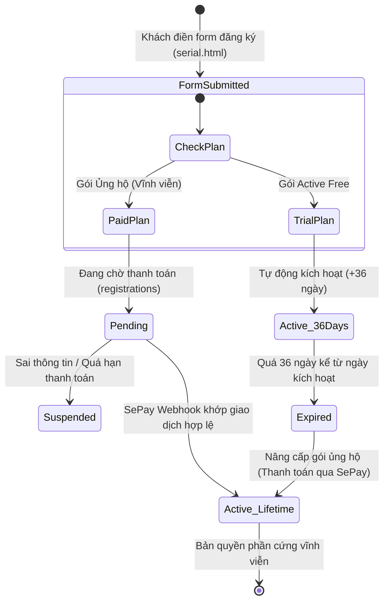

# 🛠️ Kiến Trúc Hệ Thống & Sơ Đồ Kỹ Thuật HyperUR V3 (Dành Cho Developer)

Tài liệu kỹ thuật chi tiết dành cho Developer tiếp nhận, bảo trì và phát triển tiếp hệ thống HyperUR V3.

---

## 1. 🏗️ Sơ Đồ Kiến Trúc Tổng Thể (System Architecture)

```mermaid
graph TB
    subgraph ClientLayer ["1. CLIENT LAYER (Giao Diện Người Dùng)"]
        UI_Home["Trang chủ & Kho ROM<br/>(index.html, download.html,<br/>firmware.html, guide.html)"]
        UI_Serial["Đăng ký & Tra cứu Serial<br/>(serial.html + serial.js)"]
        UI_Admin["Trang Quản Trị Hệ Thống<br/>(admin/admin.html + admin.js)"]
        UI_Users["Quản lý Tài Khoản Admin<br/>(admin-users.html + admin-users.js)"]
    end

    subgraph SecurityLayer ["2. SECURITY & MIDDLEWARE LAYER"]
        CORS["_bootstrap.php<br/>• Strict CORS (No wildcard *)<br/>• HttpOnly Lax Cookie<br/>• Session TTL Management"]
        AuthMid["admin-auth.php<br/>• Bcrypt Password Verify<br/>• RBAC: Superadmin / Admin"]
        HmacMid["_sepay-lib.php<br/>• HMAC-SHA256 Signature<br/>• Replay Window (300s)<br/>• Serial Scoring & Extraction"]
    end

    subgraph APILayer ["3. APPLICATION & API LAYER (PHP 8.x)"]
        API_Lookup["serial-lookup.php<br/>Tra cứu SN/Email"]
        API_Reg["serial-register.php<br/>Đăng ký gói Free/Paid"]
        API_QR["qr-active.php<br/>Xoay QR 5 lượt / MySQL"]
        API_Hook["payment-webhook.php<br/>Xử lý thanh toán tự động"]
        API_Serials["admin-serials.php<br/>CRUD / Renew / Export CSV"]
        API_Users["admin-users.php<br/>CRUD tài khoản admin"]
        API_Logs["admin-logs.php<br/>Audit trail log viewer"]
        API_Bot["check_serial2.php & add_serial.php<br/>Telegram Bot & Quick URL"]
    end

    subgraph DBLayer ["4. DATA LAYER (MySQL / MariaDB: ycoozxap_hyperur)"]
        T_Serial[("`serial`<br/>STT, Device, Serial, Gmail, Time")]
        T_Reg[("`registrations`<br/>serial, codename, plan, status...")]
        T_Tx[("`payment_transactions`<br/>sepay_id, amount, status, payload")]
        T_Set[("`system_settings`<br/>qr_rotation_count, configs...")]
        T_Users[("`admin_users`<br/>username, password hash, role...")]
        T_AdminLog[("`admin_logs`<br/>admin_id, action, old/new json...")]
        T_ActLog[("`activity_logs`<br/>serial, action, ip, user_agent")]
    end

    subgraph ThirdParty ["5. EXTERNAL SERVICES"]
        SePayGateway["Cổng SePay Webhook"]
        VietQRService["VietQR API (vietqr.app)"]
        TelegramService["Telegram Bot API"]
        MailService["SMTP Mailer"]
    end

    %% Client -> Middleware / API
    UI_Serial -->|GET| API_Lookup
    UI_Serial -->|POST| API_Reg
    UI_Serial <-->|GET / POST| API_QR
    UI_Admin --> CORS --> API_Serials & API_Logs
    UI_Users --> CORS --> AuthMid --> API_Users

    %% Webhook & External
    SePayGateway -->|POST Webhook| HmacMid --> API_Hook
    API_Hook -.->|Alert| TelegramService
    API_Reg -.->|Send Mail| MailService
    API_QR -.->|Render Image| VietQRService

    %% API -> Database
    API_Lookup --> T_Serial & T_Reg & T_ActLog
    API_Reg --> T_Reg & T_ActLog
    API_QR --> T_Set
    API_Hook --> T_Tx & T_Reg & T_Serial & T_Set & T_AdminLog
    API_Serials --> T_Serial & T_AdminLog
    API_Users --> T_Users & T_AdminLog
    API_Logs --> T_AdminLog
    API_Bot --> T_Serial & T_AdminLog
```

---

## 2. 🔄 Sequence Diagram: Luồng Thanh Toán Tự Động SePay

Sơ đồ trình tự chi tiết luồng xử lý từ khi người dùng quét mã đến khi bản quyền được kích hoạt tự động:

```mermaid
sequenceDiagram
    autonumber
    actor Customer as Khách Hàng
    participant Web as serial.html / serial.js
    participant QRAPI as api/qr-active.php
    participant SePay as Cổng SePay
    participant Webhook as api/payment-webhook.php
    participant DB as MySQL Database
    participant Telegram as Telegram Bot Admin

    Customer->>Web: Nhập Serial + Chọn Dòng máy
    Web->>QRAPI: GET /api/qr-active.php
    QRAPI->>DB: Đọc `qr_rotation_count` từ `system_settings`
    DB-->>QRAPI: Trả về count (VD: 3)
    QRAPI-->>Web: Active Account: NGUYEN TAN LUC (3/5)
    Web->>Customer: Hiển thị VietQR kèm cú pháp "UR [máy] [serial] [email]"

    Customer->>Customer: Mở App Ngân Hàng quét QR và Chuyển Khoản
    SePay->>Webhook: POST Webhook (kèm X-SePay-Signature, X-SePay-Timestamp)
    
    rect rgb(20, 30, 45)
        Note over Webhook: 1. Kiểm tra Timestamp chống Replay (< 300s)<br/>2. Xác thực chữ ký HMAC-SHA256 (SEPAY_WEBHOOK_SECRET)
    end

    Webhook->>DB: Kiểm tra `payment_transactions` (Chống trùng sepay_id)
    alt Giao dịch đã xử lý trước đó
        Webhook-->>SePay: HTTP 200 {"success": true, "message": "Đã xử lý"}
    else Giao dịch mới
        Webhook->>DB: INSERT INTO `payment_transactions` (status = 'unmatched')
        Note over Webhook: Bóc tách & chấm điểm tìm Serial từ nội dung CK
        Webhook->>DB: UPDATE `registrations` SET status = 'Active' WHERE serial = ?
        Webhook->>DB: INSERT INTO `serial` (STT, Device, Serial, Gmail, Time = 'unlimited')
        Webhook->>DB: UPDATE `system_settings` (Tăng qr_rotation_count +1)
        Webhook->>DB: UPDATE `payment_transactions` SET status = 'matched'
        Webhook->>Telegram: Gửi thông báo biến động số dư & kích hoạt thành công
        Webhook-->>SePay: HTTP 200 {"success": true, "matched": true}
    end

    Customer->>Web: Vào Tab Tra Cứu (serial-lookup.php)
    Web->>DB: SELECT * FROM serial WHERE Serial = ?
    DB-->>Web: Trả về trạng thái Active (Trọn Đời)
    Web-->>Customer: Hiển thị thẻ Xanh: "ĐÃ KÍCH HOẠT - VĨNH VIỄN"
```



---

## 3. 🔁 Sơ Đồ Máy Trạng Thái (State Machine): Vòng Đời Serial



---

## 4. 🗄️ Cấu Trúc Bảng Dữ Liệu (Database Schema)

| Tên Bảng | Vai trò | Khóa chính / Index quan trọng | Ghi chú |
| :--- | :--- | :--- | :--- |
| `serial` | Bảng bản quyền chính hệ thống ROM | Index `STT`, `Serial`, `Device`, `Gmail` | ROM kiểm tra thiết bị từ bảng này. `Time = 'unlimited'` hoặc ngày hết hạn `YYYY-MM-DD`. |
| `registrations` | Lưu đơn đăng ký từ website | PK `id`, Unique `serial`, Index `sender_email` | Lưu đơn đăng ký, gói đăng ký, trạng thái `Pending` / `Active`. |
| `payment_transactions` | Sổ cái nhận tiền SePay | PK `id`, Unique `sepay_id` | Chống trùng giao dịch (Idempotency), lưu payload gốc. |
| `system_settings` | Bộ đếm & cấu hình động | PK `setting_key` | Chứa `qr_rotation_count` để xoay vòng STK MBBank mỗi 5 lượt. |
| `admin_users` | Tài khoản đăng nhập Admin | PK `id`, Unique `username` | Hash mật khẩu chuẩn Bcrypt. Roles: `superadmin`, `admin`. |
| `admin_logs` | Audit trail lịch sử thao tác admin | PK `id`, Index `admin_id`, `action`, `created_at` | Ghi vết mọi thao tác thêm, sửa, xóa, gia hạn serial. |
| `activity_logs` | Nhật ký tra cứu / đăng ký của user | PK `id`, Index `serial`, `action` | Lưu vết IP và User-Agent khi user tra cứu serial. |

---

## 5. 🧩 Hướng Dẫn Mở Rộng Tính Năng Mới

### A. Thêm hoặc đổi tài khoản ngân hàng trong vòng xoay QR
Chỉnh sửa mảng `QR_ACCOUNTS` trong file `api/qr-active.php` và `serial.js`:
```php
const QR_ACCOUNTS = [
    [
        'id'   => 0,
        'name' => 'NGUYEN TAN LUC',
        'acc'  => 'VQRQAMNWP9901',
        'bank' => 'MBBank',
        'url'  => 'https://vietqr.app/img?bank=MBBank&acc=VQRQAMNWP9901&template=&showinfo=true&holder=NGUYEN%20TAN%20LUC'
    ],
    [
        'id'   => 1,
        'name' => 'NGUYEN VAN TUC',
        'acc'  => '0379050602',
        'bank' => 'MBBank',
        'url'  => 'https://vietqr.app/img?bank=MBBank&acc=0379050602&template=&showinfo=true&holder=NGUYEN%20VAN%20TUC'
    ]
    // Thêm tài khoản thứ 3 tại đây nếu cần
];
```

### B. Kiểm thử tự động (Unit / Integration Test Suite)
Sau khi chỉnh sửa code backend, luôn chạy bộ test toàn diện 81 trường hợp kiểm thử tự động:
```powershell
& C:\xampp\php\php.exe tests/test_all_features.php
```
Bộ test bao gồm:
- Tra cứu Serial (Active, Unlimited, Expired, Legacy, Email)
- Đăng ký gói Free & Paid
- Quick Add qua URL (`add_serial.php`) & Telegram Bot API (`check_serial2.php`)
- SePay Webhook HMAC-SHA256, Idempotency, Auto Active
- Admin Auth, CRUD Serial, CRUD Admin Users, Audit Logs
- QR Rotation API (Xoay vòng tài khoản thời gian thực)
