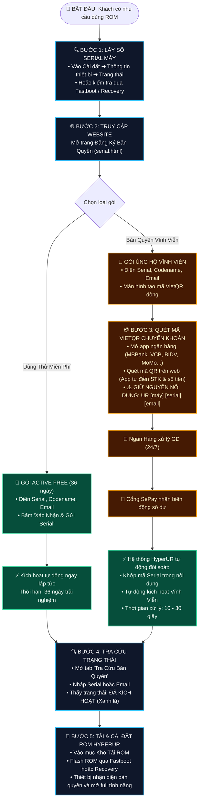

# 📖 Quy Trình Đăng Ký & Kích Hoạt Bản Quyền HyperUR (Dành Cho Khách Hàng)

Tài liệu hướng dẫn trực quan các bước đăng ký, thanh toán VietQR tự động và tra cứu kích hoạt bản quyền ROM HyperUR.

---

## 🗺️ Sơ Đồ Quy Trình Hoạt Động (Customer Journey)



---

## 📋 Chi Tiết Từng Bước Thực Hiện

### 1️⃣ Bước 1: Lấy số Serial (SN) thiết bị
- **Cách 1 (Trong hệ điều hành)**: Vào **Cài đặt** ➔ **Giới thiệu điện thoại** ➔ **Tất cả thông số** ➔ **Trạng thái** ➔ sao chép mục **Số Serial** (gồm 8 đến 16 ký tự chữ và số).
- **Cách 2 (Fastboot)**: Đưa máy về chế độ Fastboot, cắm vào máy tính gõ lệnh:
  ```bash
  fastboot getvar serialno
  ```

---

### 2️⃣ Bước 2: Điền thông tin vào Website
- Truy cập vào mục **Kích Hoạt & Tra Cứu Serial** trên website HyperUR.
- Nhập các trường:
  - **Mã dòng máy (Codename)**: Ví dụ `fuxi` (Xiaomi 13), `marble` (POCO F5), `alioth` (K40)...
  - **Số Serial thiết bị**: Dán mã Serial vừa lấy ở Bước 1.
  - **Địa chỉ Email**: Nhập email chính xác để nhận thư xác nhận và quản lý danh sách thiết bị.

---

### 3️⃣ Bước 3: Quét mã QR thanh toán (VietQR 24/7)
- Chọn mức ủng hộ tương ứng (Mặc định: **50.000đ**).
- Mở ứng dụng ngân hàng bất kỳ (MBBank, Vietcombank, Techcombank, BIDV, MoMo, ZaloPay...):
  - Chọn tính năng **Quét QR**.
  - Ứng dụng ngân hàng sẽ **tự động điền** số tài khoản nhận, tên người nhận và số tiền chính xác.
  - **Lưu ý quan trọng**: Giữ nguyên nội dung chuyển khoản tự động do web sinh ra (Mẫu: `UR marble 5A1C8D2F user@gmail.com`). Không sửa nội dung này để bot nhận diện tự động.

---

### 4️⃣ Bước 4: Hệ thống tự động kích hoạt
- Sau khi bạn bấm chuyển khoản thành công trên app ngân hàng:
  - Cổng thanh toán SePay bắn thông báo xác thực tới server HyperUR.
  - Máy chủ tự động bóc tách mã Serial và cập nhật trạng thái bản quyền thành **Active (Vĩnh viễn)**.
  - Bạn **không cần chờ admin duyệt tay**, hệ thống hoạt động tự động 24/7, kể cả đêm khuya và ngày lễ.

---

### 5️⃣ Bước 5: Tra cứu & Sử dụng ROM
- Chuyển sang tab **Tra Cứu Bản Quyền**:
  - Gõ số Serial hoặc Email vừa đăng ký.
  - Trạng thái hiển thị huy hiệu xanh: **ĐÃ KÍCH HOẠT - VĨNH VIỄN**.
- Tiến hành cài đặt bản ROM HyperUR cho thiết bị và khởi động để tận hưởng trải nghiệm mượt mà, không bị giới hạn.

---

## ❓ Câu Hỏi Thường Gặp (FAQ)

| Tình huống | Cách xử lý |
| :--- | :--- |
| **Quên không ghi nội dung chuyển khoản hoặc ghi sai?** | Đừng lo lắng! Chụp lại biên lai chuyển khoản và gửi cho Admin qua Telegram [@hypermodupdate](https://t.me/hypermodupdate) để được hỗ trợ kích hoạt thủ công trong 5 phút. |
| **Bao lâu sau khi chuyển khoản thì được kích hoạt?** | Thường từ **10 đến 30 giây** ngay sau khi ngân hàng báo trừ tiền. |
| **Cài lại ROM hoặc nâng cấp phiên bản có mất bản quyền không?** | **Không**. Bản quyền gắn liền với phần cứng (Số Serial máy), bạn có thể up lại ROM hoặc nâng cấp phiên bản thoải mái trọn đời. |
| **Tra cứu bằng Email có xem được tất cả máy đã mua không?** | **Có**. Chỉ cần gõ địa chỉ Email vào ô tra cứu, hệ thống sẽ liệt kê toàn bộ danh sách thiết bị bạn đã từng đăng ký. |
